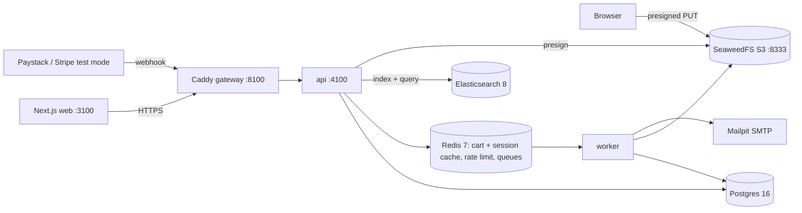
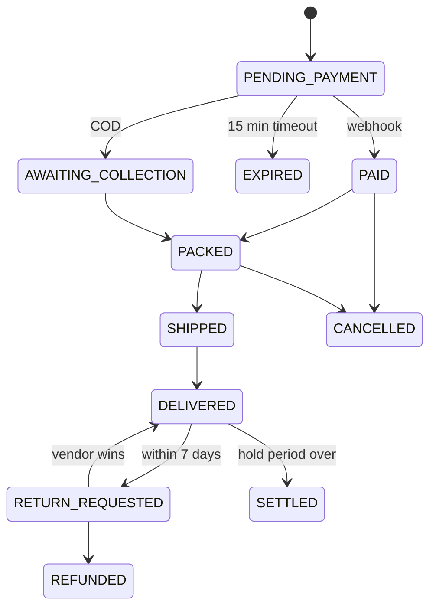
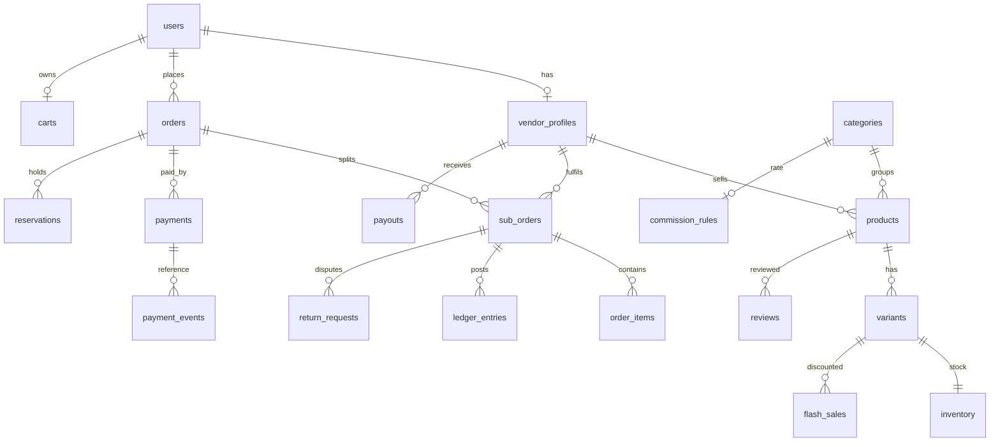

# Architecture

Modular monolith: one NestJS codebase runs as `api` (HTTP) and `worker` (BullMQ processors + periodic jobs). Next.js runs outside compose and talks to the API over HTTPS only.



## Module map (apps/api/src/modules)

| File | Responsibility |
|---|---|
| auth.ts / password-reset.ts | register/login/refresh/logout (argon2id, 15 min JWT, rotating refresh with reuse detection, Redis rate limit + lockout), `/me`, addresses, forgot/reset password (stateless signed token, see below) |
| vendors.ts | apply, KYC (presigned PUT to the private bucket), admin approve/reject/suspend, vendor state machine, public `GET /vendors`, payout bank list and Paystack recipient |
| catalog.ts | public catalog, vendor product CRUD, variants, image presign/confirm, product state machine, flash sales |
| search.ts / search-es.ts | Elasticsearch search with facets, fuzzy and prefix matching (reindex every 60 s into a fresh index + alias swap); Postgres `tsvector` + `pg_trgm` fallback |
| coupons.ts | percent/fixed coupons, atomic use count, vendor-funded pro rata |
| invoices.ts | PDF invoice per order |
| inventory.ts | reserve / commit / release as single conditional UPDATEs; expiry; low-stock |
| cart.ts | cart grouped by vendor with live price drift flags |
| checkout.ts | idempotent checkout transaction: reserve, order, per-vendor sub-orders, commission snapshot |
| payments.ts | provider port, signed webhook, `payment_events.event_id` dedupe, ledger posting, `POST /payments/paystack/verify` and `/payments/:id/verify` (both go through the webhook handler) |
| ledger.ts | append-only double-entry postings and balance/check queries |
| orders.ts | order reads, vendor ship, customer events, agent delivery (COD cash) and `GET /agent/sub-orders`, settlement job, SSE |
| returns.ts | returns, 48 h SLA, disputes, reviews (`POST` and the public `GET /products/:id/reviews`), vendor score |
| admin.ts | KPIs (including late refunds), commission rules, audit, idempotent payout run that only pays vendors with a transfer recipient |
| notifier.ts / images.ts | worker-side email + in-app notification, sharp image pipeline |

## Checkout and payment flow

```mermaid
sequenceDiagram
  participant C as Customer
  participant A as API
  participant D as Postgres
  participant Q as BullMQ
  participant P as Provider
  C->>A: POST /checkout (Idempotency-Key)
  A->>D: TX: insert checkout_requests(key) UNIQUE
  A->>D: prices recomputed from DB; UPDATE inventory SET reserved+=n WHERE on_hand-reserved>=n
  A->>D: order + sub_orders (commission snapshot) + reservations + payment
  A->>Q: delayed release-reservation (15 min)
  A->>P: initialize(reference = order id)
  A-->>C: authorization_url
  P->>A: POST /payments/webhook (HMAC-SHA512 over raw body)
  A->>D: TX: INSERT payment_events ON CONFLICT DO NOTHING
  A->>D: first delivery only: sub_orders PAID, reservations COMMITTED, ledger groups
  A-->>P: 200 (duplicates are 200 no-ops)
```

**Returning from the hosted page.** The Paystack return address is `${WEB_BASE_URL}/orders?reference=<order id>` (`WEB_BASE_URL` is the public origin plus the base path; `WEB_ORIGIN` stays the plain origin used for CORS). The web app calls `POST /payments/paystack/verify {reference}` (owner only). The API asks Paystack for the transaction and feeds the result through the same handler as the webhook, under the event key `verify:<reference>`, so a repeat call or a late webhook posts nothing twice. It answers `{status: PAID | PENDING | FAILED, orderId}`. A payment that arrives after its reservation expired is booked as a refund liability, written to the audit log with the reference and amount (`payment.late_refund_required`), and counted in the admin KPIs as `lateRefunds`.

**Payout run.** `POST /admin/payouts/run` pays only vendors that have a Paystack transfer recipient. A vendor without one is returned under `skipped` (`no payout recipient`) and keeps their balance; the ledger is posted only after the transfer call succeeds, a failed transfer rolls its transaction back and appears under `skipped`. The response is `{runKey, paid, skipped, vendorsPaid, totalKobo}`.

**Password reset.** `POST /auth/forgot` always answers 204 (and is rate limited per IP and per address). `POST /auth/reset {token, password}` accepts a JWT signed with a key derived from `JWT_ACCESS_SECRET`, valid 30 minutes and tied to a fingerprint of the current password hash, so it works once; the update is a compare-and-set on the old hash and all refresh tokens are revoked. The email is sent by the worker (it builds the token, so the token is never stored in the queue) with the link `${WEB_BASE_URL}/reset-password?token=...`. No table was added. With Mailpit as the SMTP target the message is kept, not delivered.

## Sub-order state machine



Transitions are enforced by `canTransition` (packages/shared) and applied with `UPDATE ... WHERE status IN (...)`, so two racing requests cannot both win.

## Ledger

Accounts: `gateway_clearing`, `platform_commission`, `processing_fees`, `vendor_payable_pending|available|hold` (per vendor), `payout_clearing`, `cod_clearing`, `customer_refund_due`. A vendor's "status" (pending / available / hold) is the account the money sits in; moving between them is a new posting, never an edit.

Enforced in the database, not only in code:
- `BEFORE UPDATE OR DELETE` trigger on `ledger_entries` and `payment_events`; `oja_app` role has no UPDATE/DELETE/TRUNCATE on them.
- Deferred constraint trigger: every posting group must have debits = credits at COMMIT.
- Views `vendor_balances` and `ledger_check` (admin `GET /admin/ledger/check`).

Postings per sub-order on card payment: Dr gateway_clearing gross; Cr vendor_payable_pending (gross - commission); Cr platform_commission; Dr processing_fees fee; Cr gateway_clearing fee. COD posts nothing until the agent hands over cash (Dr cod_clearing).

## Data model (ERD)



## Deployed under a subpath (the shared VM)

The same code runs at `https://<host>/oja-market-js` (web) and `/oja-market-js-api/` (API) next to other apps. `infra/compose.deploy.yml` is the overlay; it replaces the Caddy gateway, Postgres and Elasticsearch of the local stack.

```
host nginx  /oja-market-js          -> web  (built with NEXT_BASE_PATH and NEXT_PUBLIC_API_URL)
            /oja-market-js-api/     -> api  (prefix stripped, cookie paths rewritten, so the /auth refresh cookie is sent)
            /ojajs-public/...       -> SeaweedFS S3 (public bucket, anonymous read only)
            /ojajs-private/...      -> SeaweedFS S3 (signed requests only)
```

- The database is Neon (`DOCKER_DATABASE_URL`, `DOCKER_MIGRATE_DATABASE_URL`); `migrate` runs `prisma migrate deploy` before the api starts. With `ELASTICSEARCH_URL` empty, search uses the Postgres `tsvector` + `pg_trgm` path.
- **S3 must be reachable from the browser.** The API builds presigned upload URLs and image links from `S3_ENDPOINT`, so on the VM it is the public domain and the bucket paths are routed at the domain root (the names `ojajs-*` differ from other stacks that share the root). SeaweedFS reads `infra/seaweedfs/s3.deploy.json`, generated on the VM (not in git): one admin identity with random keys and an anonymous identity with `Read` on the public bucket only.
- The S3 client sets `requestChecksumCalculation: 'WHEN_REQUIRED'`. Without it the SDK adds a CRC32 of an empty body to presigned PUT URLs and every browser upload fails with `BadDigest`.
- Environment: `WEB_ORIGIN` (plain origin), `WEB_BASE_URL` (origin + base path), `S3_ENDPOINT`, `S3_BUCKET_PUBLIC|PRIVATE`, `S3_ACCESS_KEY|SECRET_KEY`, `JWT_ACCESS_SECRET`, `JWT_REFRESH_SECRET`, `PAYMENT_PROVIDER`, `PAYSTACK_SECRET_KEY`, `NODE_ENV=production`.
- With `NODE_ENV=production` the API refuses to start if a JWT secret is missing or still the dev default, if `PAYMENT_PROVIDER` is `fake`, or if it is `paystack` without a secret key.

## Deliberate deviations and simplifications

- Password reset and payment verification add no tables: the reset token is stateless and verification reuses the webhook path.
- Reviews have no title (the table has none); the list endpoint returns `{id, rating, body, authorName, createdAt}` with `authorName` shortened to first name and initial.
- The agent queue (`GET /agent/sub-orders`) lists every SHIPPED sub-order; there is no per-agent assignment field.

- Validation uses zod (shared with the web app) instead of class-validator.
- One module file per domain instead of one Nest `@Module` per domain; still a single deployable.
- Sub-order `commission_bps` is the effective rate (commission / subtotal); `commission_kobo` is the sum of per-item category rates, rounded half up per item.
- Card refunds are ledger-only; no call is made to the gateway refund API.
- Raw SQL is used where correctness depends on a single atomic statement (inventory, webhooks, payouts, search).
