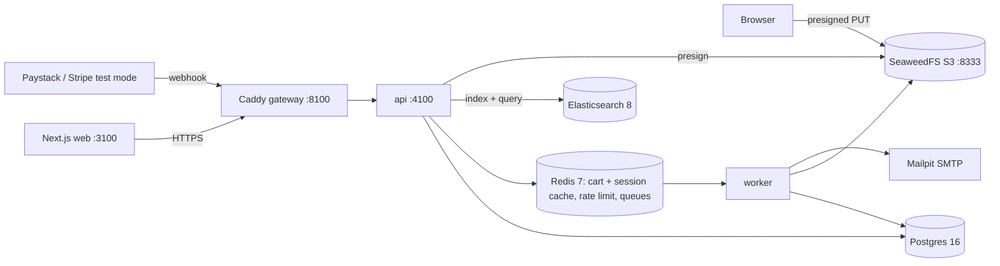
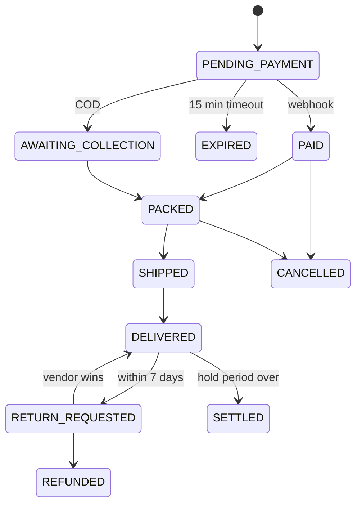
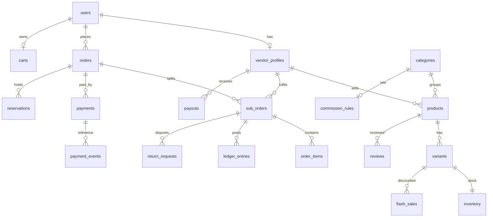

# Architecture

Modular monolith: one NestJS codebase runs as `api` (HTTP) and `worker` (BullMQ processors + periodic jobs). Next.js runs outside compose and talks to the API over HTTPS only.



## Module map (apps/api/src/modules)

| File | Responsibility |
|---|---|
| auth.ts | register/login/refresh/logout (argon2id, 15 min JWT, rotating refresh with reuse detection, Redis rate limit + lockout), `/me`, addresses |
| vendors.ts | apply, KYC (presigned PUT to the private bucket), admin approve/reject/suspend, vendor state machine |
| catalog.ts | public catalog, vendor product CRUD, variants, image presign/confirm, product state machine, flash sales |
| search.ts / search-es.ts | Elasticsearch search with facets, fuzzy and prefix matching (reindex every 60 s into a fresh index + alias swap); Postgres `tsvector` + `pg_trgm` fallback |
| coupons.ts | percent/fixed coupons, atomic use count, vendor-funded pro rata |
| invoices.ts | PDF invoice per order |
| inventory.ts | reserve / commit / release as single conditional UPDATEs; expiry; low-stock |
| cart.ts | cart grouped by vendor with live price drift flags |
| checkout.ts | idempotent checkout transaction: reserve, order, per-vendor sub-orders, commission snapshot |
| payments.ts | provider port, signed webhook, `payment_events.event_id` dedupe, ledger posting, verify |
| ledger.ts | append-only double-entry postings and balance/check queries |
| orders.ts | order reads, vendor ship, customer events, agent delivery (COD cash), settlement job, SSE |
| returns.ts | returns, 48 h SLA, disputes, reviews, vendor score |
| admin.ts | KPIs, commission rules, audit, idempotent payout run |
| notifier.ts / images.ts | worker-side email + in-app notification, sharp image pipeline |

## Checkout and payment flow

```mermaid
sequenceDiagram
  participant C as Customer
  participant A as API
  participant D as Postgres
  participant Q as BullMQ
  participant P as Provider
  C->>A: POST /checkout (Idempotency-Key)
  A->>D: TX: insert checkout_requests(key) UNIQUE
  A->>D: prices recomputed from DB; UPDATE inventory SET reserved+=n WHERE on_hand-reserved>=n
  A->>D: order + sub_orders (commission snapshot) + reservations + payment
  A->>Q: delayed release-reservation (15 min)
  A->>P: initialize(reference = order id)
  A-->>C: authorization_url
  P->>A: POST /payments/webhook (HMAC-SHA512 over raw body)
  A->>D: TX: INSERT payment_events ON CONFLICT DO NOTHING
  A->>D: first delivery only: sub_orders PAID, reservations COMMITTED, ledger groups
  A-->>P: 200 (duplicates are 200 no-ops)
```

## Sub-order state machine



Transitions are enforced by `canTransition` (packages/shared) and applied with `UPDATE ... WHERE status IN (...)`, so two racing requests cannot both win.

## Ledger

Accounts: `gateway_clearing`, `platform_commission`, `processing_fees`, `vendor_payable_pending|available|hold` (per vendor), `payout_clearing`, `cod_clearing`, `customer_refund_due`. A vendor's "status" (pending / available / hold) is the account the money sits in; moving between them is a new posting, never an edit.

Enforced in the database, not only in code:
- `BEFORE UPDATE OR DELETE` trigger on `ledger_entries` and `payment_events`; `oja_app` role has no UPDATE/DELETE/TRUNCATE on them.
- Deferred constraint trigger: every posting group must have debits = credits at COMMIT.
- Views `vendor_balances` and `ledger_check` (admin `GET /admin/ledger/check`).

Postings per sub-order on card payment: Dr gateway_clearing gross; Cr vendor_payable_pending (gross - commission); Cr platform_commission; Dr processing_fees fee; Cr gateway_clearing fee. COD posts nothing until the agent hands over cash (Dr cod_clearing).

## Data model (ERD)



## Deliberate deviations and simplifications

- Validation uses zod (shared with the web app) instead of class-validator.
- One module file per domain instead of one Nest `@Module` per domain; still a single deployable.
- Sub-order `commission_bps` is the effective rate (commission / subtotal); `commission_kobo` is the sum of per-item category rates, rounded half up per item.
- Card refunds are ledger-only; no call is made to the gateway refund API.
- Raw SQL is used where correctness depends on a single atomic statement (inventory, webhooks, payouts, search).
